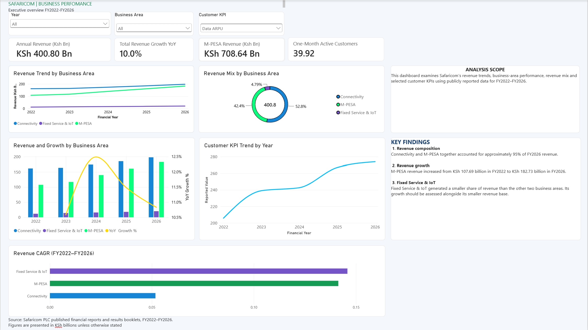

# Safaricom Commercial Performance Analysis (FY2022–FY2026)

**An interactive commercial performance analysis of Safaricom PLC using Microsoft Excel and Power BI.**

## Business Problem

Safaricom's public reports contain revenue and customer performance measures across financial years and business areas. This project brings selected measures into one interactive dashboard to make it easier to compare revenue trends, business-area contributions and customer KPIs.

**Business question:** How did Safaricom's reported revenue evolve from FY2022 to FY2026, and how did M-PESA, Connectivity and Fixed Service & IoT contribute to that performance?

## Dashboard

The Power BI dashboard includes:

* Annual revenue and total year-on-year (YoY) revenue growth.
* Revenue trends and revenue mix by business area.
* A combined revenue and YoY growth visual.
* Selected customer KPI trends, including active customers.
* Revenue CAGR comparison across the three business areas.
* Financial-year, business-area and customer-KPI slicers for interactive exploration.

## Key Findings

Based on the figures prepared for this analysis:

* **FY2026 revenue mix:** Connectivity represented approximately **49.37%**, M-PESA **45.59%**, and Fixed Service & IoT **5.04%** of the combined revenue of the three areas.
* **M-PESA revenue:** Increased from approximately **KSh 107.69 billion in FY2022** to **KSh 182.73 billion in FY2026**.
* **Connectivity revenue:** Increased from approximately **KSh 161.70 billion** to **KSh 197.87 billion** over the same period.
* **Fixed Service & IoT revenue:** Increased from approximately **KSh 11.72 billion** to **KSh 20.20 billion**.

These are descriptive observations from the prepared dataset, not explanations of what caused the changes or forecasts of future performance. Figures should be checked against the source reports and may be affected by rounding.

## Tools and Method

| Tool            | Use                                                                 |
| --------------- | ------------------------------------------------------------------- |
| Microsoft Excel | Organising data and calculating performance measures                |
| Power BI        | Data modelling, interactive visualisation and dashboard development |
| DAX             | Power BI measures and filter-aware calculations                     |

**Workflow:** Publicly reported data → structured Excel tables → YoY growth, revenue mix and CAGR calculations → Power BI dashboard → business findings.

## Data Scope

* **Company:** Safaricom PLC
* **Period:** FY2022–FY2026
* **Revenue areas:** M-PESA, Connectivity, Fixed Service & IoT
* **Additional data:** Selected publicly reported customer and usage KPIs
* **Revenue units:** KSh billions; customer metrics retain their reported units

The analysis uses public reports rather than internal transaction-level data. Reporting definitions, segment classifications and rounding may affect comparisons across years. This is a historical commercial analysis, not a forecast or a full profitability assessment.

## Project Files

* `dashboard/` — Power BI dashboard screenshot
* `data/` — source and prepared data, where included
* `excel/` — Excel workbook and calculations
* `power-bi/` — Power BI report file
* `ai/` — AI assistance worklog, if included

Open the `.pbix` file in Power BI Desktop to explore the report. If the data source path differs from the original

## AI Assistance

Generative AI was used as a learning aid for formula explanations, Power BI troubleshooting and documentation. This is an AI-assisted portfocalculations and interpretations should be reviewed against the workbook and source reports.

**Author:** Martin Waiguru
